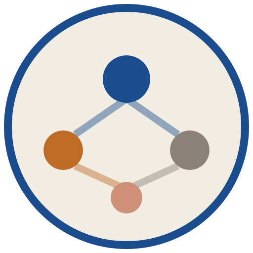
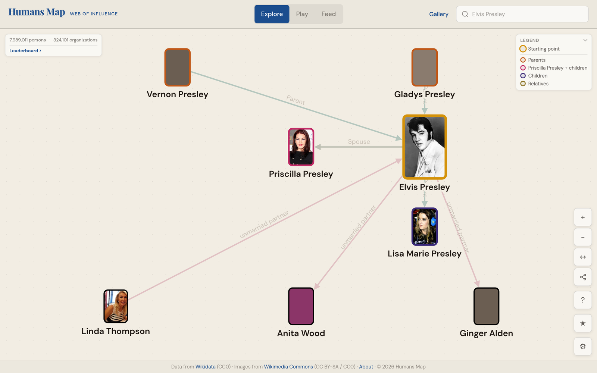
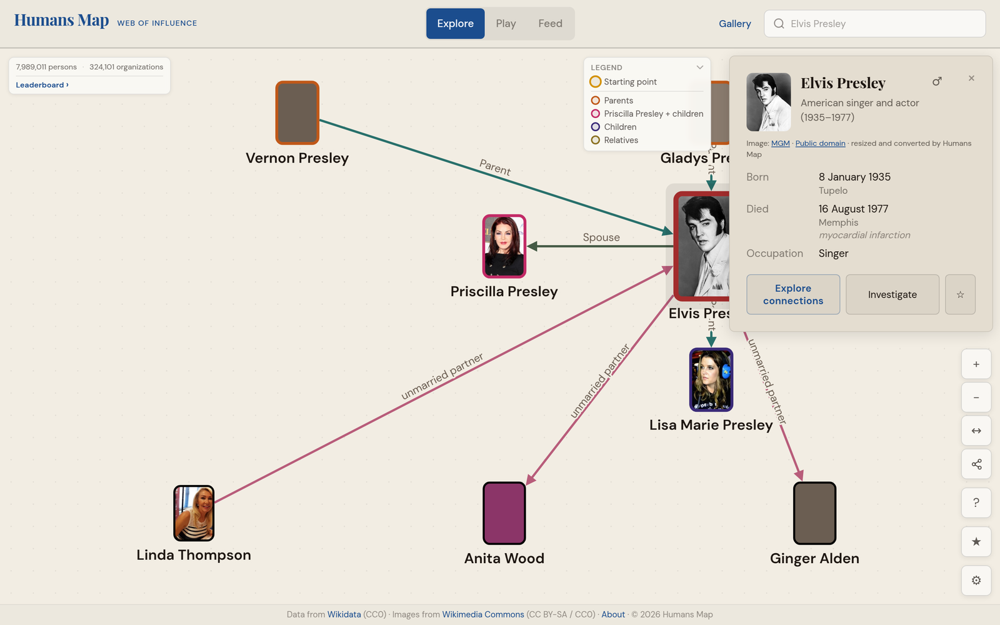
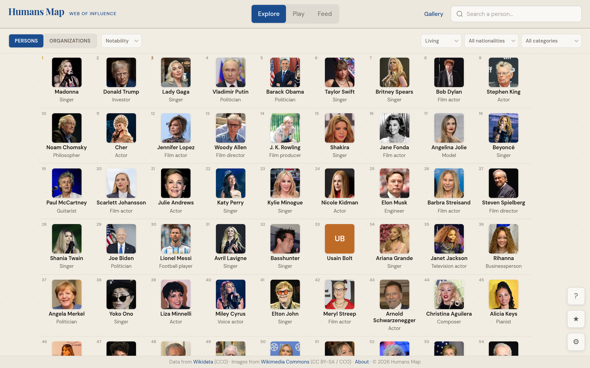
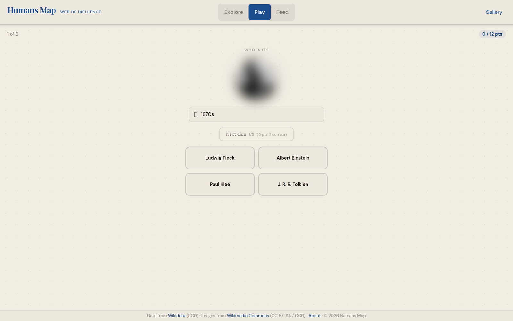
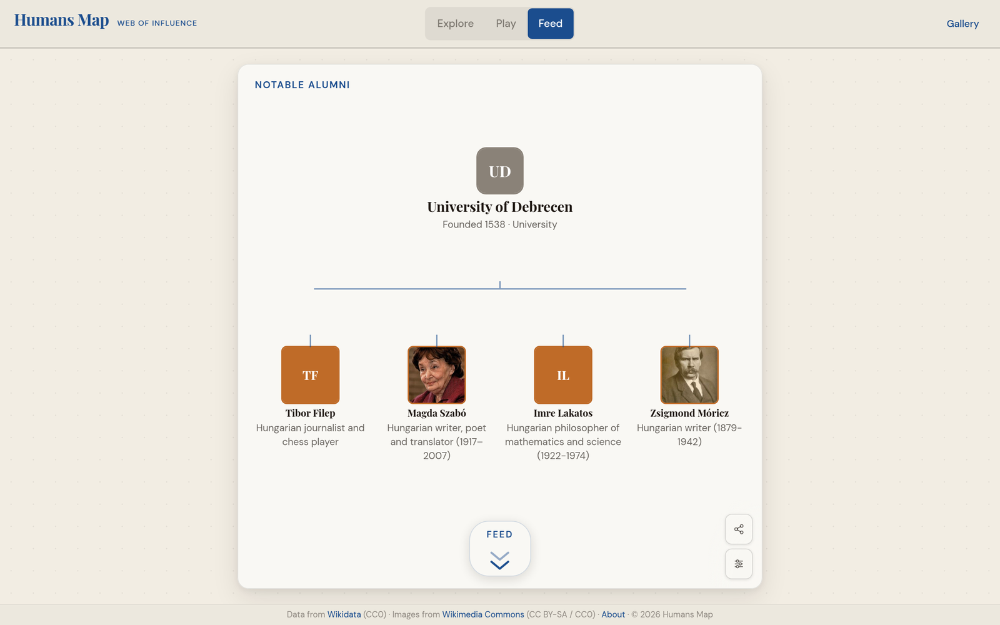

<p align="center">
  <a href="https://humansmap.com"></a>
</p>

# HumansMap

A knowledge graph for exploring connections between public figures — board
seats, executive roles, ownership stakes, share transactions, institutional
holdings.

Originally live at **[humansmap.com](https://humansmap.com)**. The hosted
service is being wound down; this repository is the permanent, open-source home
of the project.

Three ways in:

- **Explore** — an interactive graph canvas (Cytoscape.js) for browsing
  people ↔ company connections
- **Play** — a path-finding game and a trivia game built on the same graph
- **Feed** — a scrollable stream of generated connection cards

Data comes from **Wikidata** (people, organizations, basic relations) and
**SEC EDGAR** (DEF 14A directors, Form 3/4 ownership, 13F institutional
holdings). Scope is global, with deeper SEC coverage for US-listed companies.

## Screenshots

| Explore a network | Selected node detail |
|---|---|
|  |  |

| Leaderboards | Play (trivia) | Feed |
|---|---|---|
|  |  |  |

Flow recordings (WebM, captured with Playwright against the live service):
[explore](docs/media/videos/explore-flow.webm) ·
[feed](docs/media/videos/feed-flow.webm) ·
[game](docs/media/videos/game-flow.webm). More in
[`docs/media/`](docs/media/).

## Stack

| Layer | Technology |
|---|---|
| Web server | Caddy 2 |
| Frontend | Vue 3 + Cytoscape.js + Vite |
| API | FastAPI + Uvicorn (Python 3.11) |
| Database | ArangoDB 3.11 (graph + search view) |
| Cache | Redis 7 (cache-aside, optional) |
| Orchestration | Docker Compose |

## How it works

- **Ingest** — the graph is built from the Wikidata RDF dump in two passes
  (identify notability-qualifying people, then load entities and edges), with a
  daily EventStreams job for incremental patches.
- **Identity & dedup** — every entity is keyed by its Wikidata QID and edges by
  `(from, to, type, property)`, so ingestion is idempotent. SEC filings are
  joined to people through a CIK map (P5531) and a tiered name matcher.
- **Fast queries** — bounded BFS neighborhoods, `SHORTEST_PATH` over a named
  graph, and materialized leaderboards; Redis cache-aside with graceful
  fallback when Redis is down.
- **Messy filings** — a layout classifier routes DEF 14A documents to dedicated
  extractors; 13F XML is parsed in a streaming-friendly way. All SEC calls go
  through one rate-limited, caching provider.
- **Reach** — nine UI languages, server-rendered share pages with generated
  Open Graph images, and a paginated sitemap.

[`ARCHITECTURE.md`](ARCHITECTURE.md) has the full schema, API surface and data
flow.

## Try it in five minutes

The full graph needs a ~100 GB Wikidata dump. To make the project runnable
without it, the repo ships a small real slice — ~50 real public figures and
their relations, from Wikidata (CC0):

```bash
cp .env.example .env          # set ARANGO_PASSWORD and ARANGO_APP_PASSWORD
docker compose up -d --build

docker compose exec backend python scripts/seed_demo_data.py
docker compose exec redis redis-cli FLUSHDB
```

Open <http://localhost>. ArangoDB creates the database and restricted `app_user`
on first boot. See [`docs/DEMO.md`](docs/DEMO.md).

## What you can do with it

- **Learn from it** — a worked example of a graph database, a cache-aside API,
  and public-data ETL (Wikidata + SEC) in one deployable stack.
- **Run it locally** on the demo data, or on the full graph if you have the
  disk and patience. Details in [`docs/DEPLOYMENT.md`](docs/DEPLOYMENT.md).
- **Fork it** for another domain — the schema is a small, generic
  people/organization/event graph and edge types are free strings, so new types
  reach the UI without code changes.
- **Reuse a piece** — the SEC parsers, the rate-limited provider, the Cytoscape
  component, or the OG-image generator.
- **Improve the data** — corrections are welcome via the data-correction issue
  form.

## Data and license

Wikidata is CC0; Wikimedia Commons images are cached only under reusable
licenses with attribution; SEC EDGAR filings are public-domain U.S. government
works used within SEC fair-access limits. See
[`THIRD_PARTY_NOTICES.md`](THIRD_PARTY_NOTICES.md).

MIT — see [`LICENSE`](LICENSE). Bug reports and contributions welcome
([`CONTRIBUTING.md`](CONTRIBUTING.md), [`SECURITY.md`](SECURITY.md)).
